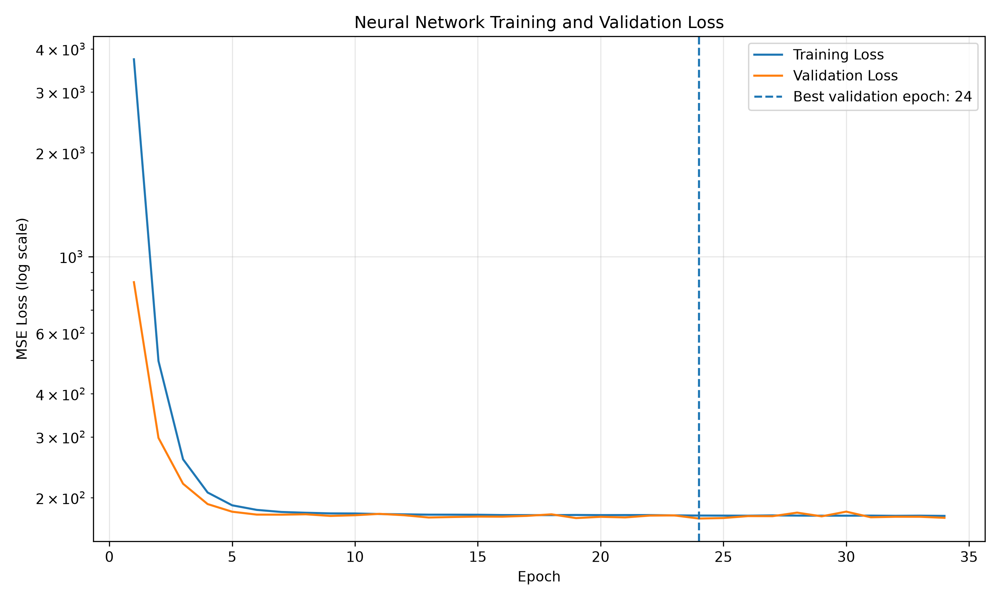
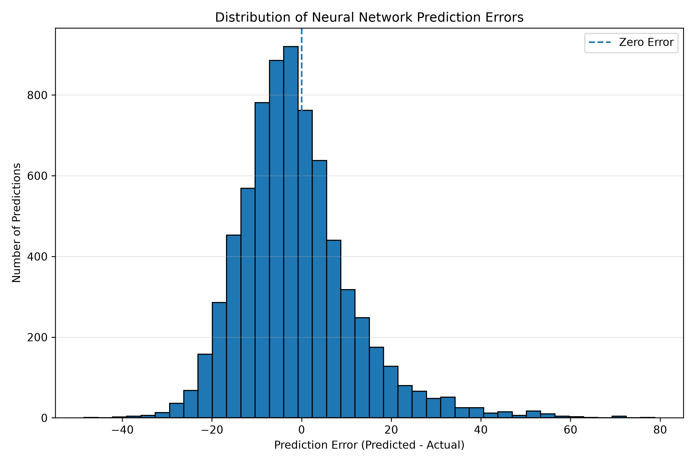
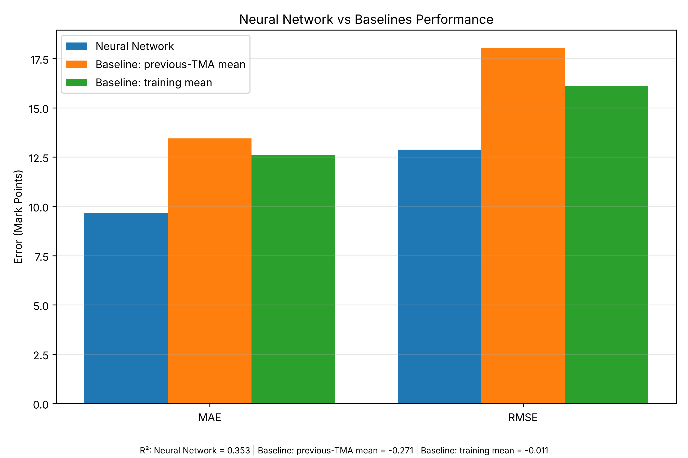

## 1. Training and Validation Loss

## 2. Actual vs Predicted Marks

## 3. Prediction Error Distribution

## 4. Model vs Baselines

NN and both shared baselines (previous-TMA mean, training mean) on the same held-out rows; see `src/baselines.py`.

# Search and CSP experiments (10 seeds, mean ± sample std) — plots in `results/search_csp/plots/`

**Exp 1: UCS vs Greedy vs A\*** (3 assignments, 3 slots/week, reachable targets). All three found a plan in 10/10 seeds with
the same cost (7.4 ± 2.0 sessions). Nodes expanded: UCS 126.7 ± 71.9, A\* 94.4 ± 60.3, Greedy 8.4 ± 2.0.
A\* uses an admissible heuristic (number of assignments still below target). Greedy matched the optimal cost here
because assignments are independent and marks are monotone; it is not guaranteed to do so in general.

**Exp 2: BT vs BT+FC vs BT+FC+AC-3** (10 seeded tight instances per capacity, shuffled deadlines). Mean backtracks:
2 slots/week 71.7 / 37.0 / 0.4; 3 slots/week 5272.6 / 2745.7 / 7.1; 4 slots/week 1871.1 / 939.6 / 0.0
(BT / FC / AC-3). AC-3 does more constraint checks per node but far fewer nodes, and wins on time at 3-4 slots.

**Exp 3: NN vs the two shared baselines** (fixed target 80; baselines from `src/baselines.py`, the same ones `src/nn/evaluate_model.py` uses).
Plans found: NN 40%, previous-mark baseline 0%, training-mean baseline 0% (both ignore effort, so they can never say sessions help).
Error vs real score: NN 8.7 ± 5.3, training mean 12.1 ± 5.8, previous mark 15.7 ± 5.9. Samples are small (10 students); the full
held-out table (7,260 rows) is in `results/nn/evaluation_metrics.csv`: NN MAE 9.7, training mean 12.6, previous mark 13.4.

**Exp 4: effort sensitivity** (`results/search_csp/effort_sensitivity.csv`, plot `exp4_effort_sensitivity.png`). The session effect is an
assumption, so the planner was run with half / default / double activity per session on the same targets. Plans found: 60% / 100% / 100%;
sessions when a plan exists: 12.3 / 7.4 / 4.7. The plan cost depends strongly on the assumed effect.

**Monotonicity (30 profiles x 8 steps):** clicks-only rule 133/240 violations (55%); new effort rule 0/240; planner guard 0/240 (raw and guarded marks are stored in separate columns of `monotonicity.csv`).
