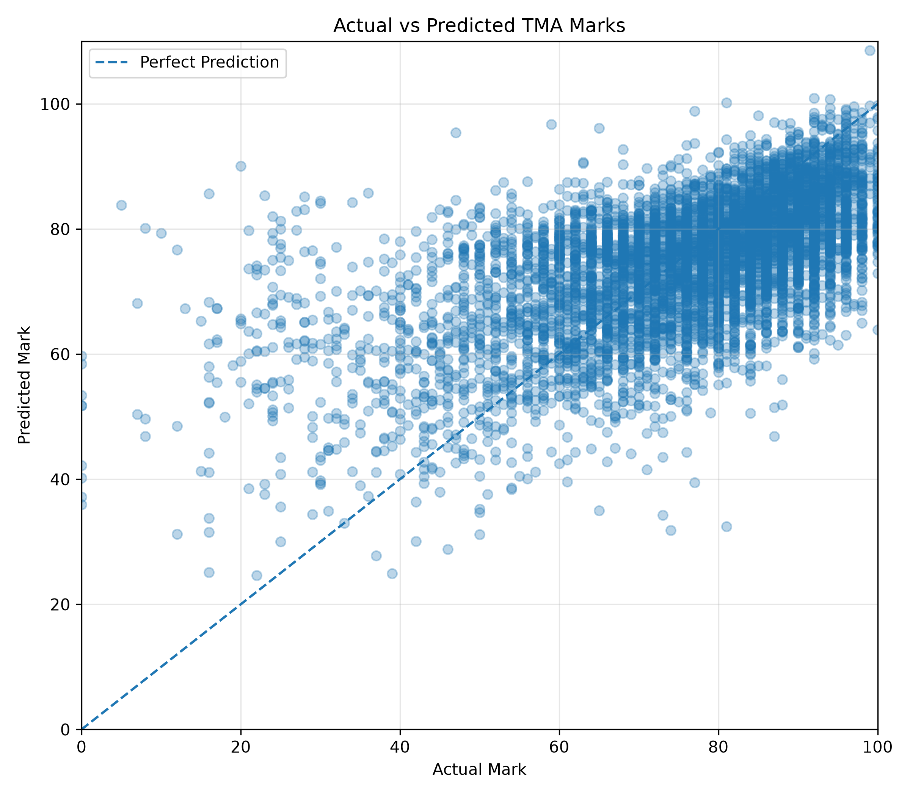

## 1. Training and Validation Loss

## 2. Actual vs Predicted Marks

## 3. Prediction Error Distribution

## 4. Model vs Baseline

# Search and CSP experiments (10 seeds, mean ± sample std) — plots in `results/search_csp/plots/`

**Exp 1: UCS vs Greedy vs A\*** (3 assignments, 3 slots/week, reachable targets). All three found a plan in 10/10 seeds with
the same cost (7.4 ± 2.0 sessions). Nodes expanded: UCS 126.7 ± 71.9, A\* 94.4 ± 60.3, Greedy 8.4 ± 2.0.
A\* uses an admissible heuristic (number of assignments still below target). Greedy matched the optimal cost here
because assignments are independent and marks are monotone; it is not guaranteed to do so in general.

**Exp 2: BT vs BT+FC vs BT+FC+AC-3** (10 seeded tight instances per capacity, shuffled deadlines). Mean backtracks:
2 slots/week 71.7 / 37.0 / 0.4; 3 slots/week 5272.6 / 2745.7 / 7.1; 4 slots/week 1871.1 / 939.6 / 0.0
(BT / FC / AC-3). AC-3 does more constraint checks per node but far fewer nodes, and wins on time at 3-4 slots.

**Exp 3: NN vs average-mark predictor** (fixed target 80). Plans found: NN 40%, average predictor 0% (it ignores effort, so
it can never say sessions help). Error vs real score: NN 8.7 ± 5.3, average 15.7 ± 5.9. Samples are small (10 students).

**Monotonicity (30 profiles x 8 steps):** clicks-only rule 133/240 violations (55%); new effort rule 0/240; planner guard 0/240.
